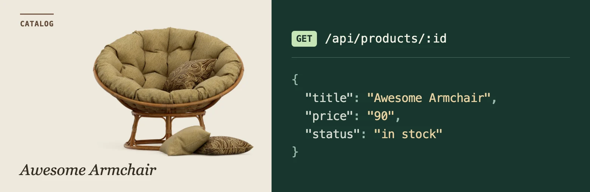

<h1 align="center">Flatlogic Ecommerce API</h1>

<p align="center">The Node.js backend for the Flatlogic furniture store and admin dashboard.<br>Express serves the catalog, customer accounts and orders from PostgreSQL through Sequelize.</p>

<p align="center">
  <a href="https://flatlogic-ecommerce.flatlogic.com/shop"><strong>Browse the live shop</strong></a>
  &nbsp;·&nbsp; <a href="#quick-start">Quick start</a>
  &nbsp;·&nbsp; <a href="https://github.com/flatlogic/ecommerce-frontend">Frontend</a>
  &nbsp;·&nbsp; <a href="changelog.md">Changelog</a>
</p>

<a href="https://flatlogic-ecommerce.flatlogic.com/shop">
  <picture>
    <source media="(max-width: 600px)" srcset="docs/images/catalog-api-mobile.webp">
    
  </picture>
</a>

The [live shop](https://flatlogic-ecommerce.flatlogic.com/shop) lets you filter products and inspect their photos. [Sign in to the demo](https://flatlogic-ecommerce.flatlogic.com/login) to manage products and orders. Changes to the public demo are reset at the start of each hour.

<a name="-quick-start"></a>

## Quick start

You'll need Node.js 24.22.3 or a later 24.x patch, Yarn Classic 1.22.22, and a local PostgreSQL server. The commands below assume your system user can create a database on `localhost`.

```sh
git clone https://github.com/flatlogic/ecommerce-backend.git
cd ecommerce-backend
yarn install --frozen-lockfile
```

Create a dedicated database for the sample catalog. The app reads `DATABASE_URL` in production mode. Here it points to your local PostgreSQL server.

```sh
export NODE_ENV=production
export DATABASE_URL=postgresql://localhost/flatlogic_shop_demo
export DB_SSL=false
export JWT_SECRET="$(openssl rand -hex 32)"

createdb -h localhost flatlogic_shop_demo && yarn reset
yarn start
```

`yarn reset` recreates the application tables and seeds nine products. The `&&` runs it only if the database was just created. To restart the API in the same shell, use `yarn start`.

**Check the catalog** from a second terminal. A freshly seeded database prints `9 products`.

```sh
curl -fsS http://localhost:8080/api/products | node -p 'JSON.parse(require("fs").readFileSync(0)).count + " products"'
```

## Explore the API

| Request | What you get |
| --- | --- |
| `GET /api/products` | Product records in `rows` and the total in `count`. |
| `GET /api/products/:id` | A single product with its images, brand and categories. Use an ID from the catalog. |
| `POST /api/auth/signin/local` | A session token for a registered user's email and password. |
| `GET /api/auth/me` | The signed-in user's profile. Send the token as `Authorization: Bearer <token>`. |

Browse the [route handlers](src/routes) for the rest of the API, or connect the [React storefront](https://github.com/flatlogic/ecommerce-frontend#quick-start) to your local server.

## Running your own instance

<details>
<summary><strong>Production settings and Docker</strong></summary>

| Setting | Purpose |
| --- | --- |
| `DATABASE_URL` | The PostgreSQL connection URL reachable from the backend. |
| `JWT_SECRET` | A private signing key. Generate it once and keep it across restarts to preserve sessions. |
| `DB_SSL` | Production uses PostgreSQL TLS by default. Set to `false` for a private database configured without TLS. |
| `PORT` | HTTP listener port. Defaults to `8080`. |

The [Dockerfile](Dockerfile) includes Node.js 24 and installs the locked dependencies. To use an existing database, export its connection settings and signing key in the shell. Use a database hostname reachable **from the container**.

```sh
docker build -t flatlogic-ecommerce-api .
docker run --rm -p 127.0.0.1:8080:8080 \
  -e DATABASE_URL -e JWT_SECRET -e DB_SSL flatlogic-ecommerce-api
```

</details>

<details>
<summary><strong>Hourly demo reset</strong></summary>

The scheduler is off by default. To run a shared demo, prepare a read-only PostgreSQL baseline before enabling `DEMO_RESET_HOURLY=true`. Each hour the backend restores the sample data in a single transaction. See the [baseline setup and verification guide](ops/demo-baseline/README.md).

</details>

## License and support

[MIT license](LICENSE) · [Latest release](https://github.com/flatlogic/ecommerce-backend/releases/latest) · [Report an issue](https://github.com/flatlogic/ecommerce-backend/issues) · [Flatlogic templates](https://flatlogic.com/templates)
